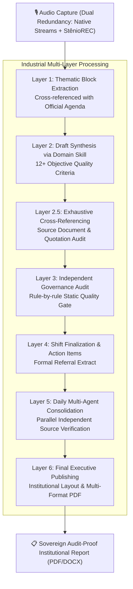
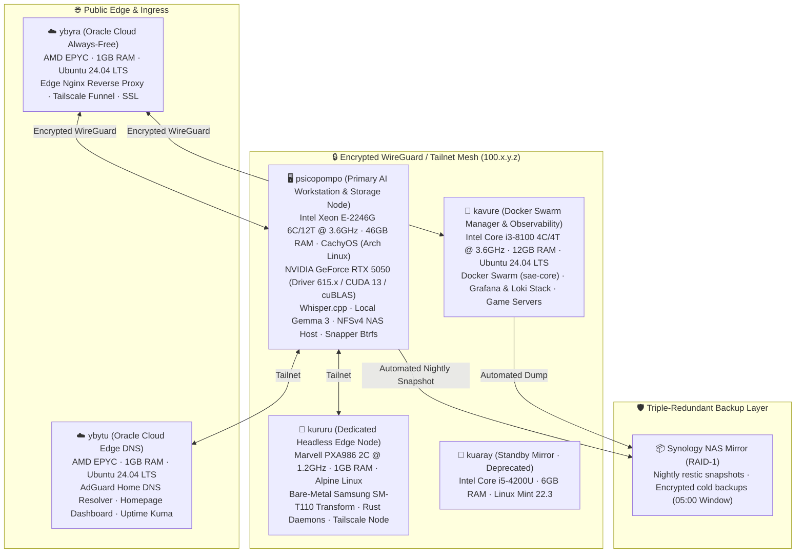

# 📋 Carlos Eduardo Rodrigues — Curriculum Vitae & Portfolio

[](https://github.com/ceduardorodrig/ceduardorodrig/actions/workflows/ci.yml)
[](LICENSE.md)
[](https://github.com/ceduardorodrig/STENIO-SENTINEL)
[-orange)](#-curriculum-versions)
[](https://github.com/ceduardorodrig/MNEMOCINE)
[](https://github.com/ceduardorodrig)

> **"Using open-source local technology ingeniously to bridge anthropology, systems engineering, and data sovereignty."**

---

## 📑 Table of Contents

- 🌍 [About](#-about)
- 📑 [Curriculum Versions (10 Dedicated Profiles)](#-curriculum-versions)
- ⚡ [Sumænimá Ecosystem — Sovereign Intelligence & Multi-Layer Bureau](#-sumænimá-ecosystem--sovereign-intelligence--multi-layer-bureau)
  - 🎙️ [StênioREC — Real-Time Sovereign Transcription & Deliberative Cockpit](#️-stêniorec--real-time-sovereign-transcription--deliberative-cockpit)
  - 📜 [Sumænimá Multi-Layer Reporting Methodology](#-sumænimá-multi-layer-reporting-methodology)
  - 🤖 [Sumænimá Social Media Autopilot — Autonomous Rust Engine](#-sumænimá-social-media-autopilot--autonomous-rust-engine)
  - 🃏 [Arandu TCG & Cockpit de Voo (Cosmic FAB)](#-arandu-tcg--cockpit-de-voo-cosmic-fab)
  - ⚡ [Architectural Breakthroughs (100% Native Rust Stack)](#-architectural-breakthroughs-100-native-rust-stack)
- 🛡️ [StenioSentinel v4.6.0 — Universal Rust AI Governance Sentinel](#️-steniosentinel-v460--universal-rust-ai-governance-sentinel)
- 🖥️ [Mnemocine Homelab Infrastructure (6 Hybrid Nodes)](#️-mnemocine-homelab-infrastructure-6-hybrid-nodes)
  - 🔒 [Encrypted Mesh & GitOps Tailnet Policy (`MNEMOCINE-ACL`)](#-encrypted-mesh--gitops-tailnet-policy-mnemocine-acl)
- 📦 [Featured Repositories & Open-Source Engineering](#-featured-repositories--open-source-engineering)
- 📊 [By the Numbers](#-by-the-numbers)
- 🧵 [The Thread (Narrative)](#-the-thread-narrative)
- 📸 [Fieldwork & Photographic Archive](#-fieldwork--photographic-archive)
- 📚 [Publications & Media](#-publications--media)
- 📜 [License](#-license)
- 📬 [Contact](#-contact)

---

## 🌍 About

I am a **hybrid product architect, systems engineer, and anthropologist** based in Brasília, Brazil. 

Throughout my decade-long trajectory, I have designed and deployed high-performance technological systems that turn complex, unstructured human and territorial realities — traditional community territorial claims, high-level governmental deliberative assemblies, and qualitative ethnographies — into actionable, verifiable, and sovereign digital assets.

This repository hosts my comprehensive curriculum vitae organized across **10 dedicated profiles** (including specialized technical tracks and an on-site IT/business continuity coringa profile for local enterprises), fully synchronized and version-controlled in both **English (US)** and **Brazilian Portuguese (PT-BR)**. 

The accompanying ecosystem reflects an ongoing life endeavor encompassing **~110,000 lines of authored production code** (including **53,000+ LOC in pure Rust 2024** and **18,000+ LOC in TypeScript/React 19**), sovereign hybrid infrastructure, and structured documentation governed by deterministic, verifiable rules.

---

## 📑 Curriculum Versions

Choose the profile that matches your focus:

### 🇺🇸 English (US)

| # | Profile | Target Audience & Focus | Document Link |
|:---:|:---|:---|:---:|
| **00** | **🛠️ General — On-Site IT & Support (coringa)** | General-purpose version for distributing to businesses: on-site IT & technical support, networking, POS, backups & LGPD, with digital product as a differentiator | [`en-us/00-general-ti-product-en.md`](en-us/00-general-ti-product-en.md) |
| **00s** | **💻 Services Flyer (SUMÆNIMÁ MEI)** | One-page services & pricing sheet to leave at stores and small businesses | [`en-us/00-services-flyer-en.md`](en-us/00-services-flyer-en.md) |
| **01** | **🖥️ Tech / Product / Data** | Technology companies, AI/data startups, senior product engineering roles | [`en-us/01-tech-product-data-en.md`](en-us/01-tech-product-data-en.md) |
| **01b** | **📊 Tech / Business Data** | Enterprises, consultancies, process diagnostics, data analytics & automation | [`en-us/01-tech-business-data-en.md`](en-us/01-tech-business-data-en.md) |
| **01c** | **🎯 Product Architecture** | Digital product architecture, agile delivery, tech-for-good, platform strategy | [`en-us/01-tech-pm-en.md`](en-us/01-tech-pm-en.md) |
| **01d** | **🎧 Product & Technical Support** | Digital product support, ticket triage, documentation & usability, product analysis | [`en-us/01-tech-product-support-en.md`](en-us/01-tech-product-support-en.md) |
| **01e** | **📈 Data & Analytics** | Data analysis, ETL, dashboards & reporting, databases, monitoring & evaluation, technical documentation | [`en-us/01e-data-analytics-en.md`](en-us/01e-data-analytics-en.md) |
| **01f** | **📣 Communications & PR** | Public relations, media monitoring & opportunity tracking, editorial calendars, approvals, reporting, digital marketing, SEO & link building | [`en-us/01f-communications-pr-en.md`](en-us/01f-communications-pr-en.md) |
| **02** | **🌳 Socioenvironmental-Tech** | Research institutes, international foundations, NGOs, climate impact initiatives | [`en-us/02-socioenvironmental-tech-en.md`](en-us/02-socioenvironmental-tech-en.md) |
| **02b** | **🏛️ Socioenvironmental (Institutional)** | Public agencies, multilateral governance, land demarcation, traditional communities policy | [`en-us/02-socioenvironmental-niche-en.md`](en-us/02-socioenvironmental-niche-en.md) |

### 🇧🇷 Português (PT-BR)

| # | Versão | Público & Foco | Arquivo |
|:---:|:---|:---|:---:|
| **00** | **🛠️ Geral — TI em Estabelecimentos & Suporte (coringa)** | Versão geral para distribuir em lojas e empresas: TI e suporte técnico presencial, redes, PDV, backups e LGPD, com produto digital como diferencial | [`pt-br/00-geral-ti-produto-br.md`](pt-br/00-geral-ti-produto-br.md) |
| **00s** | **💻 Flyer de Serviços (SUMÆNIMÁ MEI)** | Folha única de serviços e preços para deixar em lojas e pequenos negócios | [`pt-br/00-servicos-flyer-br.md`](pt-br/00-servicos-flyer-br.md) |
| **01** | **🖥️ Tech / Produto / Dados** | Startups de tecnologia, empresas de produto, vagas em engenharia de dados e IA | [`pt-br/01-tech-produto-dados-br.md`](pt-br/01-tech-produto-dados-br.md) |
| **01b** | **📊 Tech / Dados & Negócios** | Empresas, diagnóstico de processos, consultoria em dados e inteligência de negócios | [`pt-br/01-tech-dados-negocios-br.md`](pt-br/01-tech-dados-negocios-br.md) |
| **01c** | **🎯 Arquitetura de Produto** | Arquitetura de produtos digitais, liderança ágil, impacto socioambiental e estratégia | [`pt-br/01-tech-pm-br.md`](pt-br/01-tech-pm-br.md) |
| **01d** | **🎧 Produto & Suporte Técnico** | Suporte a produto digital, triagem de chamados, documentação e usabilidade, análise de produto | [`pt-br/01-tech-produto-suporte-br.md`](pt-br/01-tech-produto-suporte-br.md) |
| **01e** | **📈 Dados & Analytics** | Análise de dados, ETL, painéis e relatoria, bancos de dados, monitoramento e avaliação, documentação técnica | [`pt-br/01e-dados-analytics-br.md`](pt-br/01e-dados-analytics-br.md) |
| **01f** | **📣 Comunicação & Relações Públicas** | Relações públicas, monitoramento de mídia e oportunidades, calendários editoriais, aprovações, relatoria, marketing digital, SEO e link building | [`pt-br/01f-comunicacao-pr-br.md`](pt-br/01f-comunicacao-pr-br.md) |
| **02** | **🌳 Socioambiental-Tech** | Institutos de pesquisa, organismos multilaterais, fundações, projetos de impacto socioambiental | [`pt-br/02-socioambiental-tech-br.md`](pt-br/02-socioambiental-tech-br.md) |
| **02b** | **🏛️ Socioambiental (Institucional)** | Órgãos públicos, regularização fundiária, políticas para Povos e Comunidades Tradicionais (PCTs) | [`pt-br/02-socioambiental-nichado-br.md`](pt-br/02-socioambiental-nichado-br.md) |

---

## ⚡ Sumænimá Ecosystem — Sovereign Intelligence & Multi-Layer Bureau

> *"Sumænimá is born from the union of **Ænima** (the vital breath, restless strategy, and creative spark) and **Sumé** (the civilizing mythical creator who masters technique, structure, and order from chaos). We are the bridge: soul with method, technique with soul."*

Sumænimá operates as an independent technological venture, sovereign data processing bureau, and autonomous software laboratory. Rather than delegating critical intelligence to extractive corporate clouds, Sumænimá delivers end-to-end data sovereignty through native Rust systems, local neural inference, and strict multi-layer quality control.

<p align="center">
  
  
  
</p>

### 🎙️ StênioREC — Real-Time Sovereign Transcription & Deliberative Cockpit

**Status:** 🟢 **Production** — Battle-tested and certified in historic federal assemblies and high-stakes policy meetings.

<p align="center">
  
</p>

- **Client-Side DSP via Rust WebAssembly:** High-fidelity 16kHz audio capture through browser `AudioWorklet`. Buffers are normalized, pre-filtered, and analyzed with acoustic RMS Voice Activity Detection (VAD) inside compiled Rust WebAssembly before streaming.
- **Dual-Stage Neural Inference:**
  1. *Sub-500ms Draft Stage:* Ultra-fast speech recognition powered by whisper.cpp with native CUDA 13 acceleration on NVIDIA GeForce RTX 5050 (Blackwell sm_120 architecture).
  2. *Parallel Semantic Purification:* Contextual cleansing, speaker disambiguation, and parliamentary punctuation powered by local Gemma 3 IT.
- **Anti-Loop Shield & Local Agreement:** Real-time heuristic agreement engine eliminates hallucination loops and timestamp drift during multi-hour deliberative sessions.
- **Air-Gapped Offline Resilience:** Two-tier local buffer (57 MB RAM ring + 171 MB IndexedDB cache) guarantees up to 2 hours of continuous recording during complete network blackouts without a single lost audio packet.
- **Zero-Cloud Data Sovereignty:** 100% of raw audio and inference remains within encrypted local homelab hardware (`psicopompo`), with optional OAuth streaming directly to live shared documents.

#### 📋 Battle-Tested Institutional Deployments:
- 🏛️ **Presidency of Brazil / Palácio do Planalto (CNPCT):** Live documentation and legal reporting for the National Council of Traditional Peoples and Communities, including the historic 22nd Assembly presenting the Land Regularization Decree with Minister **Marina Silva**.
- 📊 **IPEA (Institute for Applied Economic Research):** Official reporting for Movements 5 (Integration) and 7 (Information Management) during the institute's Multi-Year Strategic Planning summit.
- 🏫 **FLONA de Tefé (Central Amazonia):** Intensive ethnographic reporting for 39 community leaders in the *"Formar Protagonistas"* program (IEB / APAFE / Rainforest Trust).
- 🌱 **National Sociobiodiversity Youth Assembly:** Multilateral leadership meetings with IEB, CNS, MCM, and CONFREM.
- 🌰 **OCA (Brazil Nut Observatory):** Live reporting across extractive and traditional community meetings in the Amazon basin.

---

### 📜 Sumænimá Multi-Layer Reporting Methodology

Sumænimá transforms transcription and reporting from unpredictable craft into an **auditable industrial process** governed by deterministic quality checkpoints:



- **Total Rastreability:** Every editorial decision and summary point is cross-referenced back to timestamps and verified source quotes.
- **Same-Day Turnaround:** Preliminary structured reports delivered on the exact same morning or afternoon of the assembly.

---

### 🤖 Sumænimá Social Media Autopilot — Autonomous Rust Engine

**Status:** 🟢 **Production** — Autonomous social media operation engineered in pure Rust.

A stateless, ultra-reliable autonomous daemon executing the full lifecycle of content intelligence:
`Harvest → Triage → LLM Drafting → Deterministic Guardrails → Multi-Channel Publishing → Metrics Ingestion → Algorithmic Feedback Loop`.

- **One Engine, Many Personas:** Single compiled Rust harness reading structured persona packs (YAML) to drive distinct voices across Bluesky, X, LinkedIn, and Instagram.
- **Resilient Multi-Provider Fallback:** Dynamic runtime probing prioritizing OpenCode (`mimo-v2.6-flash`), falling back to Gemini Developer API, and concluding on local homelab Ollama (Gemma 3 on RTX 5050).
- **Deterministic Rust Guardrails:** Absolute separation of concerns: brand safety, blocklist compliance, and tone verification are enforced by deterministic Rust rules — never delegated to probabilistic LLMs.
- **GPU Scheduling Protocol:** Strict zero-CPU fallback rule; VRAM is claimed on demand and freed immediately upon pipeline completion.

---

### 🃏 Arandu TCG & Cockpit de Voo (Cosmic FAB)

- **Arandu TCG Platform:** Sub-millisecond computational engine (`arandu-engine` in Rust) calculating mana curves, rarity distributions, and card economics. High-refresh React 19 UI featuring an interactive 3x3 virtual trade binder and algorithmic P2P trade radar backed by PostgreSQL 16 + `pgvector`.
- **Flight Cockpit (Cosmic FAB):** Zero-network-overhead client-side 3D inertial space flight simulation easter egg featuring Canvas 3D warp rings, dynamic starfield, telemetry HUD, and real-time procedural audio synthesis via native Web Audio API.

---

### ⚡ Architectural Breakthroughs (100% Native Rust Stack)

```
                     ┌─────────────────────────────────────────────────────────┐
                     │            stenio-server (Native Rust Binary)           │
                     │   Axum 0.8 · Tokio Work-Stealing · SQLx · whisper.cpp   │
                     └────────────────────────────┬────────────────────────────┘
                                                  │
                 ┌────────────────────────────────┼────────────────────────────────┐
                 ▼                                ▼                                ▼
   ┌───────────────────────────┐    ┌───────────────────────────┐    ┌───────────────────────────┐
   │    HTTP REST & Frontend   │    │  WebSocket Audio Daemon   │    │     Arandu Engine TCG     │
   │  SPA React 19 + MD3 PWA   │    │  Whisper CUDA 13 (sm_120) │    │  In-Memory Heuristics     │
   │  Catalogs / Auth / CMS    │    │  Local Agreement & Purify │    │   Curves, CMC & Binders   │
   └───────────────────────────┘    └───────────────────────────┘    └───────────────────────────┘
```

- **Zero Dynamic Runtimes:** Eliminated legacy Python, FastAPI, uvicorn, PyTorch, and Celery dependencies.
- **Radical RAM Efficiency:** Server idle memory dropped from ~2.5 GB to **~25 to 35 MB**.
- **Container Footprint:** Production Docker CUDA image shrank from ~20 GB to **~500 MB**.
- **Cold Boot Speed:** Startup latency accelerated from ~20 seconds to **< 100 milliseconds**.
- **True Multi-Core Concurrency:** Tokio work-stealing runtime maximizing hardware saturation without GIL bottlenecks.

---

## 🛡️ StenioSentinel v4.6.0 — Universal Rust AI Governance Sentinel

Developed to eliminate the acute hazards of autonomous coding agents (sycophancy, hallucinated tests, silent regressions, suppressed linters, and dependency bloat), **StenioSentinel** is our static analysis and architectural governance sentinel written in pure **Rust 2024**.

```
══════════════════════════════════════════════════════════════════════════════
StenioSentinel (Rust Engine v4.6.0) — Universal Governance System [79.37ms]
══════════════════════════════════════════════════════════════════════════════
── Documentation & Traceability Subsystem ─────────────────────
   ✅ 80 technical documents audited and intact.
── Quality Gate Verdict ───────────────────────────────────────
   🛡️ Zero bypass tolerance enforced: all rules validated.
```

- **Sub-100ms Monorepo Auditing (<80ms):** Validates entire workspaces and git diffs in parallel using Rayon multi-threading.
- **Mandatory Quality Gate (Rule 0):** Zero tolerance for blind commits, fake stubs, unhandled `.unwrap()` / `.expect()` calls in production Rust, unbounded channels, or suppressed comments (`// @ts-ignore`, `// stenio-ignore`).
- **Sectorized Governance Scopes:**
  - `stenio --scope hub`: Enforces backend architecture, frontend reactivity, and ADR standards.
  - `stenio --scope homelab`: Audits network mounts, systemd units, Tailscale topologies, and documentation integrity.
  - `stenio --scope vault`: Enforces Obsidian YAML metadata, official tag taxonomies (`_tags.md`), and markdown link validity.
  - `stenio --scope all`: Comprehensive system-wide multi-subsystem audit.
- **Automated Remediation (`--fix`):** Safely and deterministically resolves taxonomy anomalies, frontmatter drift, and formatting regressions.

---

## 🖥️ Mnemocine Homelab Infrastructure (6 Hybrid Nodes)

The **Mnemocine Homelab** operates as a sovereign, self-hosted 6-node hybrid infrastructure connecting bare-metal workstations, edge cloud gateways, dedicated headless nodes, and container clusters:



### 🔒 Encrypted Mesh & GitOps Tailnet Policy (`MNEMOCINE-ACL`)
- **GitOps-Managed Tailnet:** Tailscale network access policies are managed strictly as code in the private [`MNEMOCINE-ACL`](https://github.com/ceduardorodrig/MNEMOCINE-ACL) repository, tested via GitHub Actions and federated OAuth credentials before automatic deployment.
- **Zero Secrets in Git:** Cryptographic SOPS and age keyrings protect environment files across all nodes.
- **Triple-Redundant Backups:** Local Snapper Btrfs snapshots, offsite encrypted Restic backups to NAS storage, and automated documentation mirroring via `homelab-docs-sync`.

---

## 📦 Featured Repositories & Open-Source Engineering

### 🌟 AI Governance, Platforms & Sovereign Media
- **[`STENIO-SENTINEL`](https://github.com/ceduardorodrig/STENIO-SENTINEL)** (Rust 2024 · Public)  
  Sub-millisecond static governance engine, anti-bypass quality gate, and architectural integrity sentinel for AI coding agents.
- **[`SUMAENIMA-HUB`](https://github.com/ceduardorodrig/SUMAENIMA-HUB)** (Rust / React 19 / TypeScript 6 · Private Core Platform)  
  Sovereign local-first intelligence platform, real-time ethnographic transcription cockpit (Whisper + Gemma 3), and Arandu TCG knowledge engine.
- **[`SUMAENIMA-SOCIALMEDIA-AUTOPILOT`](https://github.com/ceduardorodrig/SUMAENIMA-SOCIALMEDIA-AUTOPILOT)** (Rust 2024 · Public Engine · AGPL-3.0)  
  Stateless autonomous social media engine: trend harvesting, LLM drafting, deterministic guardrails, and metrics feedback loop.

### 🖥️ Systems Engineering, Linux & Hardware Daemons
- **[`WITH-SMOOTH-MOTION`](https://github.com/ceduardorodrig/WITH-SMOOTH-MOTION)** (Rust 2024 · Public)  
  Dynamic adaptive tearing governor and direct scanout manager for high-refresh-rate Wayland compositors (Hyprland / Linux gaming).
- **[`KURURU-TAB3LITE-LINUX`](https://github.com/ceduardorodrig/KURURU-TAB3LITE-LINUX)** (Rust / Alpine Linux · Public)  
  Bare-metal headless Linux transformation and hardware control daemons in Rust for the Samsung Galaxy Tab 3 Lite (SM-T110), turning legacy ARM tablets into persistent homelab nodes.
- **[`MCMOJAVE-CURSOR-UNIFIED`](https://github.com/ceduardorodrig/MCMOJAVE-CURSOR-UNIFIED)** (Rust 2024 · Public)  
  Dual-spec unified McMojave cursor theme (Hyprcursor vector + 1:1 calibrated XCursor) powered by a native Rust asset builder.
- **[`macrokey-driver`](https://github.com/ceduardorodrig/macrokey-driver)** (Python · Public Fork)  
  Cross-platform user-space driver for configuring custom 6-button USB macro keyboards with rotary encoder (VID:1189 PID:8890).

### 🌐 Sovereign Homelab & GitOps Tooling
- **[`MNEMOCINE`](https://github.com/ceduardorodrig/MNEMOCINE)** (Shell / Markdown · Public)  
  6-node sovereign hybrid cloud architecture, bare-metal AI infrastructure, and self-hosted service manifests.
- **[`MNEMOCINE-ACL`](https://github.com/ceduardorodrig/MNEMOCINE-ACL)** (HuJSON / CI · Private)  
  Tailnet policy as code managed via GitHub Actions and Tailscale federated identity.
- **[`MNEMOCINE-OPS`](https://github.com/ceduardorodrig/MNEMOCINE-OPS)** (Rust 2024 · Private)  
  Homelab operational tooling: Rust utilities, systemd automation, and custom deployment daemons.

### 📄 Native Rust CLI Tools & Specialized Document Parsers
- **`docx-extractor`** (Rust 2024 · Native Binary)  
  Blazing-fast native extractor for parsing complex meeting minutes, Microsoft Teams transcripts, and multi-speaker governmental records into clean, structured Markdown.
- **`validador-roteiro`** (Rust 2024 · Native Binary)  
  Syntactic and semantic audiovisual script validator enforcing timing, formatting, and character consistency rules.

---

## 📊 By the Numbers

| Metric | Measurement | Context |
|:---|:---:|:---|
| **Production Codebase** | **~110,000 LOC** | Authored production code: 53k+ pure Rust 2024, 18k+ TSX/TS, zero bloated dependencies |
| **Active Repositories** | **12+ Repositories** | Monitored, versioned, and continuously synchronized under StenioSentinel |
| **Hybrid Homelab Nodes** | **6 Nodes** | psicopompo, kavure, kururu, ybyra, ybytu, kuaray (standby) |
| **Governance Static Audit** | **< 80 ms** | Whole-vault and codebase static analysis cycle |
| **Neural Inference Latency** | **< 500 ms** | Real-time local Whisper transcription response on RTX 5050 hardware |
| **Trajectory** | **10 years** | Integrating anthropology, systems engineering, and public policy |
| **Audience Reached** | **2+ Million** | Led digital campaigns and documentary productions at IPAM |
| **Traditional Territories Mapped** | **+2,500 communities** | Co-architect and field ethnographer for the *Tô no Mapa* platform |

---

## 🧵 The Thread (Narrative)

My career looks non-linear only until you recognize the recurring pattern: **Throughout my journey, I have used technology to bridge worlds that rarely speak to one another.**

I began in 2017 as an intern and field researcher at the **ISPN** (Society, Population, and Nature Institute). Deep in the Brazilian Cerrado, conducting ethnographic fieldwork with traditional riverside and quilombola populations, I confronted a staggering reality: official government maps accounted for only **28% of traditional territories**. The remaining 72% simply did not exist in the eyes of the state — rendering these communities invisible to basic sanitation, healthcare, and territorial defense.

What I learned in the dust and water — that data is not merely numbers, but living memory, territory, and struggle — led me to co-architect the [**Tô no Mapa Platform**](https://tonomapa.org.br/). By placing intuitive spatial mapping tools directly into the hands of indigenous and traditional youth, we helped register over 2,500 communities, creating an official database now integrated directly into the Federal Public Prosecutor's Office (MPF).

At **IPAM** (Amazon Environmental Research Institute, 2022–2025), I evolved from communications analyst to digital strategist. I spearheaded institutional growth that delivered **+143% digital engagement**, reached over **2 million people**, served as Scrum Master for cross-functional teams, co-directed a science documentary on Amazonian climate extremes, and received a Mercosur Science Journalism Award. Yet, this intense period also brought clarity: managing conventional institutional public relations was not my calling. Burnout arrived hand-in-hand with conviction.

In 2024, I channeled every lesson learned into building **Sumænimá** — the independent technological venture I had conceived years earlier. My core thesis was clear: **Sensitive community and institutional data must never depend on foreign corporate AI clouds.**

Since 2025, that vision has been tested at the highest echelons of public deliberation. As the official rapporteur for the **National Council of Traditional Peoples and Communities (CNPCT)**, my platform **StênioREC** operated inside the **Palácio do Planalto**, capturing, indexing, and purifying the historic proceedings that culminated in the Land Regularization Decree, inaugurated by Environment Minister **Marina Silva**.

To sustain this work independently, I constructed the **Mnemocine Homelab**: six networked nodes running open-source systems, orchestrated through Tailscale, Docker Swarm, and native Rust daemons, proving that sovereign local artificial intelligence is both feasible and superior.

Today, I stand as a **hybrid**: a product architect and systems engineer who thinks like an ethnographer. I translate ambiguous human needs into resilient distributed software, and complex systems architecture into lasting socio-environmental impact. Locally, I also bring that discipline back to the everyday: a general profile and a services sheet ([`pt-br/00-geral-ti-produto-br.md`](pt-br/00-geral-ti-produto-br.md)) for supporting stores and small businesses in Brasília with on-site IT, networking, backups and LGPD.

---

## 📸 Fieldwork & Photographic Archive

A visual testimony to the fieldwork and institutional assemblies shaping this platform:

| | |
|:---:|:---:|
|  |  |
| **2017** · Quilombola, fishing, and vazanteira community of Caraíbas [Pedras de Maria da Cruz \| MG] | **2017** · Technical mission for ISPN / PPP-ECOS community projects [Rosário \| MA] |
|  |  |
| **2018** · Free Land Camp (Acampamento Terra Livre - ATL) [Brasília \| DF] | **2019** · *Tô no Mapa* mapping workshop at Federal University of Tocantins [Arraias \| TO] |
|  |  |
| **2019** · Gathering of Cerrado Peoples — *Tô no Mapa* Launch [Brasília \| DF] | **2021** · Expedition gate at Fazenda Canadá, Chapada dos Veadeiros National Park [Cavalcante \| GO] |
|  |  |
| **2024** · Scientific expedition at Tanguro Research Station with IPAM & Woodwell [Querência \| MT] | **2024** · Rainfall exclusion experiment analyzing Amazon forest resilience [Querência \| MT] |
|  |  |
| **2025** · Public Forests Policy Workshop with IPAM [Santarém \| PA] | **2025** · FLONA de Tefé leadership delegation inside the National Congress [Brasília \| DF] |
|  |  |
| **2025** · Trainees of the *"Formar Protagonistas"* cohort from Central Amazonia [Brasília \| DF] | **2026** · National Council of Traditional Peoples meeting with the Chief of Staff, Palácio do Planalto [Brasília \| DF] |

---

## 📚 Publications & Media

- **Academic Journal Article (Co-author):**  
  Moser, P.; de Castro Silva, I.; Benedetti Figueiredo, I.; Favilla, K.; Bustamante, M.; Macedo, M.N.; de Araújo, R.F.; Shimbo, J.Z.; Varela, V.; **Rodrigues, C.E.**; Alencar, A.A.  
  *"Institutional Invisibility Threatens the Lands and Livelihoods of Traditional Communities in the Northern Brazilian Cerrado"* — Submitted to **Land Use Policy** (Elsevier, 2026).
  > Fieldwork conducted during ethnographic studies at the University of Brasília (UnB) and technical advisorship at ISPN, documenting unmapped territories across the Cerrado biome.

- **Analytical Essay:**  
  Rodrigues, C.E. *"Doenças são sintomas de uma crise cultural e ambiental"* (*Diseases are Symptoms of a Cultural and Environmental Crisis*) — **JOTA**, Em Clima de Justiça (2026). [Read Online](https://www.jota.info/opiniao-e-analise/colunas/em-clima-de-justica/doencas-sao-sintomas-de-uma-crise-cultural-e-ambiental).

- **Documentary Feature:**  
  *RUA PARA QUE(M)?* (85 min, 2020) — Direction, cinematography, and editing. Premiered by Sumænimá.

- **Documentary Short:**  
  *Manaus Extrema* (2024) — Co-direction and narrative editing. Produced by IPAM.

---

## 📜 License

- **Software, Scripts & Tooling:** [MIT License](LICENSE.md)
- **Content, Written Profiles & Documentation:** [Creative Commons Attribution 4.0 International (CC-BY-4.0)](https://creativecommons.org/licenses/by/4.0/)

---

## 📬 Contact

- 📧 **Email:** [ceduardorodrig@gmail.com](mailto:ceduardorodrig@gmail.com)
- 📱 **Phone / WhatsApp:** +55 (61) 9-9803-3546
- 💼 **LinkedIn:** [linkedin.com/in/c-eduardo-rodrigues](https://linkedin.com/in/c-eduardo-rodrigues)
- 🐙 **GitHub:** [github.com/ceduardorodrig](https://github.com/ceduardorodrig)
- 🌐 **Sumænimá:** [sumaenima.chimaera-heptatonic.ts.net](https://sumaenima.chimaera-heptatonic.ts.net)
- 📍 **Location:** Brasília, DF, Brazil (UTC-03:00)

---

<div align="center">

### 🛡️ Human-in-the-Loop Agentic Engineering & Deterministic Governance

> **Architected by an Anthropologist, Built with Autonomous AI Agents, Governed by Deterministic Code.**
> 
> This project was developed through rigorous human-AI pair programming led by **Carlos Eduardo Rodrigues** ([@ceduardorodrig](https://github.com/ceduardorodrig)) — an anthropologist, systems engineer, and product architect using autonomous coding agents under strict, sub-millisecond static governance.
>
> Every commit, driver, and system architecture is continuously audited and enforced by 🤖 **[StenioSentinel](https://github.com/ceduardorodrig/STENIO-SENTINEL)** (our native Rust quality gate) with zero tolerance for hallucinated tests, blind merges, or bypassed checks.

</div>
